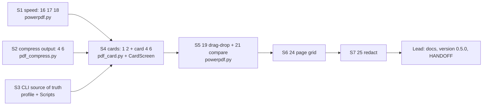

# PowerPDF — build plan

Date: 2026-10-07. Read `HANDOFF.md` first. Its gotchas and verification rules apply to every step.
Item numbers 1–15 come from the HANDOFF backlog. Numbers 16 and up are new.

## Decisions (user, 2026-10-07)

- **Scope:** all four tiers: 16, 17, 18 → 1, 2, 4, 6 → 19, 21 → 24, 25. Also the folder rename (30) and making the app the only source of truth for the CLI.
- **Card output (1):** replaces the white A4 sheet completely. No option to keep it.
- **CLI:** the profile functions call the app's modules through the app's `.venv`. The copies in `C:\Users\GSSG\Scripts\` are retired by moving them to the Recycle Bin, not deleting them.
- **Folder:** the app lives in `C:\Users\GSSG\projects\powerpdf\`. `powerdpf` is gone.
- **Safety:** use git. Make one commit per item. Do not push anywhere (there is no remote).

## Roles

- **Lead:** the omp agent in Herdr workspace "powerpdf plan". It slices the work, sends each slice to a subagent, reviews the diff, runs the checks and commits. The lead does not write feature code itself.
- **Subagents:** every `task` call sets `model: "anthropic/claude-sonnet-5-5"` on **every** task item. Give each subagent the full slice text from below plus the HANDOFF gotchas. Subagents start with no memory of this conversation.
- **Never run two subagents on the same file at the same time.** `powerpdf.py` is one file of about 1,050 lines, and most items touch it.

## Step 0: setup (done before the lead starts; the lead checks it)

1. All app files are in `projects\powerpdf\`. `projects\powerdpf\` no longer exists.
2. `uv sync` has rebuilt `.venv`, because the old venv's editable finder pointed at `powerdpf`.
3. `git init` and a baseline commit "baseline 0.4.0" (with `.gitignore` covering `.venv/`, `__pycache__/` and `.pytest_cache/`).
4. `uv run --frozen pytest -q` shows **11 passed**.

## Baselines (measured 2026-10-07; report before and after numbers for each)

| What | Baseline |
|---|---|
| `import powerpdf` (warm, venv) | 3.5–8.4 s. cv2, numpy, pypdf and PIL all load at import. `pdf_compress` costs ~1.1 s cumulative |
| Preview of the WhatsApp certificate, page 1 | `scale=1.5` gives a 2852×4047 image in 374 ms |
| Preview of the license scan, page 1 | 894×1263 in 227 ms |
| Page flip `[` `]` | Reopens the PDF and renders again every time; no cache |
| Card output | A4 at 2480×3508, 300 dpi, q92 → `90363.pdf` is 467 KB |
| `-c` compress metadata | `/Title: '.90363_small.tmp'` plus creation and modification dates |

## Waves

Wave 1 runs S1, S2 and S3 in parallel, because they touch different files. Every later slice runs alone.

---

### S1: speed (16, 17, 18). File: `powerpdf.py`

- **16, deferred imports.** `pdf_card`, `pdf_compress`, `pdf_merge` and `pdf_split` are imported at the top of the file (lines 36–39). They pull in cv2, numpy, pypdf and PIL. Import them inside the action or worker that uses them. Keep the textual_image import at the top: the comment at line 20 says it must load before the app starts. Test monkeypatches target `powerpdf.SETTINGS`, `powerpdf.send2trash` and `powerpdf.os`; these must keep working.
  - Accept when: after `import powerpdf`, `cv2` and `pypdf` are not in `sys.modules` (numpy too, unless textual_image needs it; report which). Report the median of 3 warm `-X importtime` runs, before and after.
- **17, preview at the size it is shown.** `load_preview` (line ~679) renders at a fixed `scale=1.5`. Choose the scale so the long side of the render is no bigger than what the preview panel can show (use the panel's size in cells times the terminal's cell pixel size if textual_image exposes it; otherwise cap the long side at 1600 px). Never render above `scale=1.5`.
  - Accept when: the certificate page renders at ≤1600 px on its long side, and its render time is reported before and after. Take a pilot screenshot and confirm the preview is still sharp in Sixel mode and in pixel mode (`v`).
- **18, cache.** Keep the current `PdfDocument` open while the same file is selected. Close it when the selection changes and when the app exits, always under `PDFIUM_LOCK`. Keep a small LRU of rendered pages keyed by `(path, mtime_ns, page, scale)`, so a changed file is never served stale. After a page is shown, render the next page in advance in the same worker group.
  - Accept when: a second visit to a page does not call render (prove it with a counter or a log line in a throwaway script). Flipping pages on the license scan feels instant. `test_preview_pages` still passes.

### S2: compress output (4, 6). File: `pdf_compress.py`

- **4, strip metadata** from every `_small.pdf`. Remove Title, Author, Subject, Keywords, Creator, CreationDate and ModDate. A generic Producer is allowed. This covers both the Pillow path (the `-c` save at line ~76, which today leaks the `.tmp` staging name as its title) and the Ghostscript path. The iOS Producer and dates must not survive. Use pypdf, which is already installed. Add no new dependency.
- **6, JPEG `optimize=True`** on the `-c` save.
- Accept when: in a `$env:TEMP` copy of the license scan and the WhatsApp certificate, run plain `ebook` and `-c ebook`. Each output's `PdfReader(f).metadata` contains at most `/Producer`. Sizes are equal to or smaller than the HANDOFF measurements. The extracted image of the license card is still readable. `test_compress_plain_and_cut_to_content` passes.

### S3: one source of truth for the CLI. Files: profile lines 17–20, `C:\Users\GSSG\Scripts\`

- Point `pdfSplit`, `pdfMerge` and `pdfCompress` at `C:\Users\GSSG\projects\powerpdf\.venv\Scripts\python.exe C:\Users\GSSG\projects\powerpdf\pdf_<x>.py`, and `pdfPrint` at `C:\Users\GSSG\projects\powerpdf\pdf_print.ps1`. Edit only those 4 lines.
- Move `Scripts\pdf_split.py`, `pdf_merge.py`, `pdf_compress.py` and `pdf_print.ps1` to the Recycle Bin (`send2trash` is in the venv). Leave everything else in `Scripts\` alone.
- Accept when: in a new `pwsh`, each command's `-h` works, and `pdfSplit`, `pdfMerge` and `pdfCompress` run on a `$env:TEMP` copy that includes an Arabic-named file, with exit codes 0, 1 and 2 as described in HANDOFF. Test `pdfPrint` **only** with the throwaway `'pdfPrint test'` printer on `nul:` from HANDOFF. **Never send anything to the SHARP.**

### S4: cards (1, 2, plus 4 and 6 for card output). Files: `pdf_card.py`, `CardScreen` in `powerpdf.py`

- **1.** Replace `compose()` (the A4 sheet) with output of the cards only. Use 2 pages, front then back. Each page is the size of the straightened crop at **150 dpi**, JPEG **q80**, `optimize=True`. An ID-1 card should come out at about 85.6×54 mm. Reuse `find_cards`, `cut` and `pair_cards`; do not write a second detector. Keep the default name `<stem>_card.pdf`. The prompt "Save front + back as" stays.
- **2.** In `CardScreen`, a new key `j` ("Save JPG") writes `<stem>_front.jpg` and `<stem>_back.jpg` from the same crops (150 dpi, q80, optimize). Use the same overwrite checks as the PDF save (`output_checks`).
- **4 and 6 for cards:** no metadata beyond a generic Producer; the JPEGs carry no EXIF.
- Delete or rewrite the test `test_card_front_and_back_on_one_page` so it checks the new contract: 2 pages, each card-sized, front first. Do not keep any A4 assertions.
- Accept when: on the license reference (`Downloads\Scans\20261007_102850.pdf`, **read-only**, so work on a copy), the PDF is ≤ about 100 KB with 2 card-sized pages. The JPGs are about 40 KB each. View the extracted images: the card text must be readable.

### S5: feel (19, 21). File: `powerpdf.py`

- **19, drag and drop.** Windows Terminal pastes the quoted path(s) when a file is dropped. Handle `Paste` at app level only when no `Input` has focus. Parse the paths with `shlex.split(posix=False)` and strip the quotes. Queue existing `.pdf` files; if a folder is dropped, go to it. Ignore text that is not a path, and show one toast with the count queued.
  - Accept when: a pilot test posts a `Paste` with two quoted paths (one Arabic name, one with spaces) and both are queued. Pasting into the Go-to-folder input still works as normal.
- **21, before/after.** Key `d` ("Compare") on a file `X.pdf` whose `X_small.pdf` exists, or on `X_small.pdf` itself, opens a screen with both page-1 previews side by side. Each side shows its size, and the screen shows the % saved. `[` and `]` flip both together; `Esc` closes. Reuse the S1 render and cache code.
  - Accept when: a pilot screenshot on the license plus its `_small` copy shows both sides with the correct sizes.

### S6: page grid (24). File: `powerpdf.py`

- Key `t` ("Pages") opens a grid of thumbnails for every page of the highlighted PDF. Render the thumbnails in a worker and reuse the S1 cache; the grid stays responsive on a 50-page file.
- Keys: `space` selects a page; `r` rotates the selected pages 90°; `delete` removes them; `shift+←/→` moves them; `x` extracts the selected pages to a new file; `enter` saves.
- Saving writes `<stem>_edited.pdf` with pypdf, using the same overwrite checks. The original is never changed.
- Accept when: in a pilot test on a 3-page PDF, you delete page 2, rotate page 1 and save. The result has 2 pages with the correct order and rotation. Extracting pages 1 and 3 gives a 2-page file.

### S7: redact (25). Files: `pdf_card.py`, `CardScreen`

- In `CardScreen`, key `b` adds a black box on the current side. The existing arrow, `shift`+arrow and `tab` keys move and resize whichever box is active (or the crop, when no box is active); `backspace` removes the active box. The boxes are painted into the crop's pixels before saving, so the PDF and the JPG both contain only the painted image.
- Accept when: in the output, every pixel inside each box is pure black, and each page has exactly one image (check with pypdf). A pilot test covers adding a box, moving it, removing it and saving.

### Lead wrap-up

- Bring the descriptions up to date: the `pyproject.toml` description, the module docstring and the argparse description must list explore, preview, merge, split, print, compress, card, pages, redact and compare. Bump `VERSION` and the pyproject version to **0.5.0**.
- Rewrite `HANDOFF.md`: where the code lives now (one copy), the new keys, the new measurements, and the backlog items still open (3, 5, 7, 9–15, 20, 22, 23, 26–29).
- Delete any throwaway scripts. Run the full `pytest -q` and one final manual smoke in the real TUI.

## Rules for every slice

- Keep diffs small; ponytail rules apply. Use only libraries already installed: pypdf, pypdfium2, Pillow, numpy, OpenCV, Textual, textual-image and send2trash. **Ask the user before adding any dependency.**
- Run tests with `uv run --frozen pytest -q` after every slice. Commit only when they are green; the message names the item numbers.
- Smoke tests use copies in `$env:TEMP`. Never modify originals in `Downloads`. Include an Arabic-named file.
- Never send print jobs to `SHARP BP-50C31 PCL6`.
- bash → pwsh: write a temporary `.ps1`; do not use `pwsh -Command '…'` with embedded quotes.
- If a slice cannot meet its acceptance check, the lead stops and asks the user. Do not ship a reduced version.
