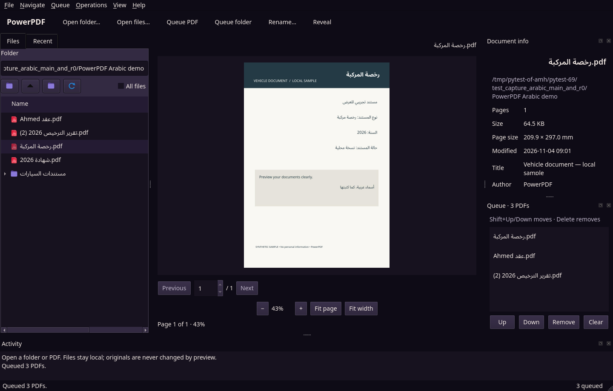
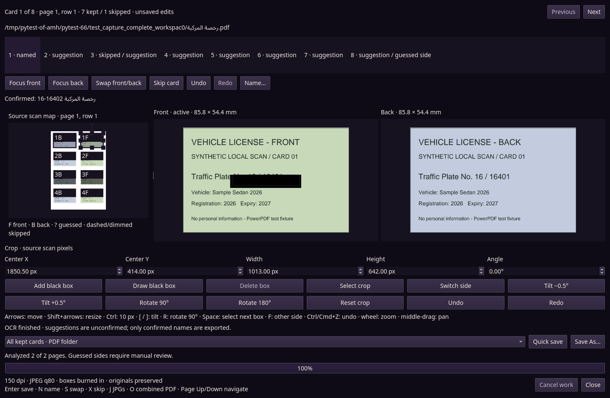
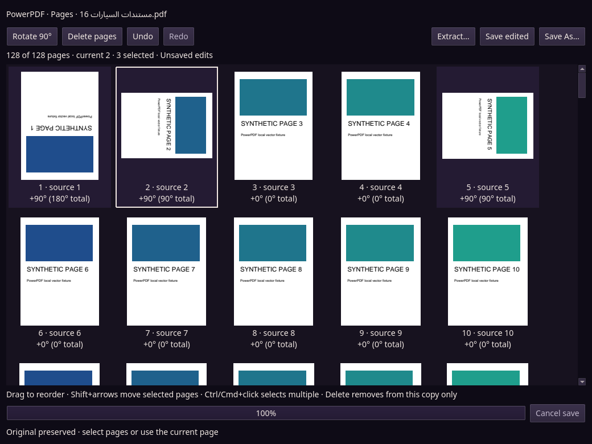
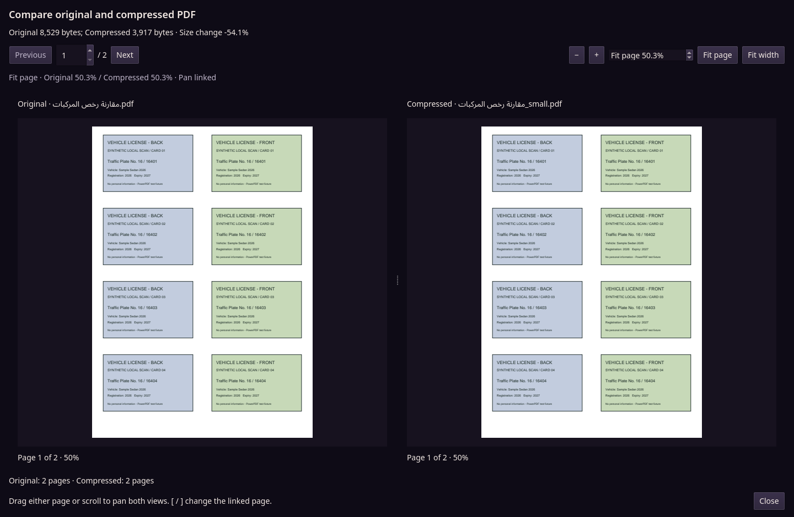

# PowerPDF

**Local PDF tools for desktop, terminal, and command-line workflows.**

**0.8.0 is the first GUI release.** The desktop app is the primary interface;
the existing terminal tools remain available.

PowerPDF combines a native desktop GUI with a keyboard-driven terminal interface and focused PDF commands. Browse documents, prepare a queue, preview pages, and turn scans into useful outputs without uploading your files to a service. Arabic filenames are handled natively alongside other Unicode filenames; you do not need to transliterate them.



## What you can do

- **Browse and preview:** open PDFs or folders, navigate pages, zoom, manage a queue, and return to recent files.
- **Everyday PDF operations:** merge documents, split PDFs, compress copies, and export pages as images.
- **Card workspace:** review scanned cards, adjust crops and front/back assignments, apply masks, confirm filenames, and save card outputs. Local OCR can suggest identifying numbers; review and explicitly confirm suggestions before using them in filenames.
- **Pages grid:** select, reorder, rotate, delete, and extract pages, with undo/redo while editing.
- **Compare:** inspect the original alongside its compressed copy before choosing what to keep.
- **Print:** review the print dialog and submit a job to the system printer queue.
- **Choose your interface:** use the desktop app, the terminal workspace, or individual command-line tools backed by the shared PDF engine.

### Card workspace



### Pages grid



### Compare view



Screenshots use synthetic documents, not real personal records.

## Download and install

Get release assets, **when available**, from the [GitHub Releases page](https://github.com/janooh37-hue/powerpdf/releases). Choose an asset for your operating system and architecture. The instructions below describe the supported package formats; they do not imply that every asset has already been published.

Packaged releases bundle the application and its runtime dependencies, including Ghostscript, Tesseract, and the supplied OCR data. You do not need a separate Python installation or separate PDF/OCR tools for those bundles. Source installations have different requirements; see below.

### Windows

- **Installer (`setup.exe`):** download the Windows setup executable from the release and run it, then launch PowerPDF from the installed shortcut.
- **Portable ZIP:** extract the entire archive to a writable folder and run the PowerPDF executable inside it. Keep the extracted files together; do not run the executable directly from the ZIP.

Unsigned downloads may trigger Windows security warnings. Check the download source before deciding whether to proceed; do not disable system-wide protections.

### macOS

Choose the **arm64 DMG** for Apple Silicon or the **x86_64 DMG** for Intel Macs. Open the DMG and drag **PowerPDF.app** into **Applications**.

The app is unsigned. If macOS blocks it, try right-clicking PowerPDF in Applications and choosing **Open**, then confirm the system prompt if offered. Organizational security policy may still prevent launching unsigned apps.

Only if you trust the downloaded release and understand the security implication, you can optionally remove the app's quarantine attribute:

```sh
xattr -dr com.apple.quarantine /Applications/PowerPDF.app
```

This removes a macOS download-security marker from that app; it is not a safety check. Never use it to bypass warnings for an untrusted download.

### Linux

For an **AppImage**, download it into a folder containing only that AppImage,
then make it executable and run it:

```sh
chmod +x ./*.AppImage
./*.AppImage
```

For a **Debian/Ubuntu `.deb`**, put the downloaded package in its own folder and
install it with APT:

```sh
sudo apt install ./*.deb
```

Launch PowerPDF from your application menu after installing the package. Your desktop's normal display and printing services are still required.

## Desktop quick start

1. Open a folder or select PDF files.
2. Highlight a PDF to preview it. Add files to the queue for batch operations and arrange the queue in the desired order.
3. Choose an operation from **Operations**, or open the card workspace, pages grid, or comparison view.
4. Review the destination and any overwrite prompts before saving. Keep a backup of important originals.

### Practical keyboard shortcuts

Single-letter workspace shortcuts apply when you are **not typing into a text field**. Standard Open and Print shortcuts use Command on macOS.

| Shortcut | Action |
| --- | --- |
| `Ctrl/Cmd+O` | Open PDF files |
| `Ctrl+Shift+O` | Open a folder |
| `Ctrl+L` / `Ctrl+R` | Go to a folder / refresh |
| `Space` | Toggle the selected PDF in the queue |
| `A` / `X` | Queue the current folder / clear the queue |
| `Shift+Up` / `Shift+Down` | Reorder the selected queue entry |
| `[` / `]` | Previous / next preview page |
| `Ctrl+0` / `Ctrl+1` | Fit page / fit width |
| `M` / `S` / `C` / `I` | Merge / split / compress / images |
| `K` / `T` / `D` | Cards / pages grid / compare |
| `Ctrl/Cmd+P` | Open the print dialog; does not automatically submit |
| `F2` | Rename the selected file |
| `Delete` | Trash a browser file or remove a queue entry, depending on focus |
| `Ctrl+Shift+P` | Find a command |
| `F1` | Show keyboard help |

Use the menus and keyboard-help dialog for the remaining commands.

## Run from source

Requirements:

- Python **3.12 or newer** and [uv](https://docs.astral.sh/uv/).
- **Ghostscript**, installed separately and available on `PATH`, for compression and workflows that use it.
- **Tesseract**, installed separately and available on `PATH`, with **English (`eng`)** traineddata, for local card-number OCR suggestions. Arabic filenames and typing do not require Arabic OCR data.
- A graphical desktop for the GUI; an interactive terminal for the terminal workspace.

Install Ghostscript and Tesseract with your operating system's package manager or their official distributions. Unlike packaged releases, `uv sync` installs Python dependencies, not those external programs or their language data.

You can also unpack the source archive for a published release and run the same
`uv` commands from that directory.

```sh
git clone https://github.com/janooh37-hue/powerpdf.git
cd powerpdf
uv sync

# Native desktop interface
uv run powerpdf-gui

# Interactive terminal interface
uv run powerpdf
```

### Command-line tools

The installed commands are `powerpdf`, `powerpdf-gui`, `pdfsplit`, `pdfmerge`, `pdfcompress`, and `pdfimage`. Run these examples from the source checkout, replacing the input paths with your own:

```sh
# Split a PDF
uv run pdfsplit "document.pdf"

# Merge inputs in the supplied order
uv run pdfmerge "first.pdf" "second.pdf" -o "combined.pdf"

# Compress a copy (quality: screen, ebook, or printer)
uv run pdfcompress "document.pdf" -q ebook

# Crop white margins during compression (rasterizes pages)
uv run pdfcompress "scan.pdf" --crop

# Export pages as PNG images at 300 DPI
uv run pdfimage "document.pdf" --format png --dpi 300

# Unicode filenames work without renaming
uv run pdfcompress "مستند.pdf"
```

The individual PDF tools accept files and/or folders; without a path, they use the current folder. Use each command's `--help` for details. Compression writes `<name>_small.pdf` beside the input and can replace an existing copy with that name; it does not change the original. Cropping during compression turns pages into images, so their text is no longer selectable. Merge requires `--force` to overwrite an existing output.

### Tests

From the checkout with development dependencies installed:

```sh
QT_QPA_PLATFORM=offscreen uv run --frozen pytest -q
```

The environment-variable syntax above is for a POSIX shell. This is the test command, not a claim that tests have been run for your checkout.

## Privacy and important limits

- **Processing and OCR are local.** PowerPDF does not upload your documents to a cloud OCR or PDF-processing service.
- **Local state remains on your machine.** The app stores settings, recent-file information, and history locally. Consider that state, as well as exported files, when working on shared machines.
- **Card masks are for card outputs, not general PDF redaction.** They are not a document-wide secure-redaction tool and do not sanitize the source PDF or unrelated copies. Review exported card files before sharing them.
- **Printing reports submission, not physical completion.** A submitted job means the job was handed to the printing system; it does not prove paper came out of the printer. Check the printer queue and device for completion or errors.
- **OCR suggestions can be wrong.** Review numbers, names, crops, and page assignments before exporting sensitive documents.

## License and third-party software

PowerPDF is licensed under **GNU AGPL-3.0-or-later**. See [LICENSE](LICENSE) for the full terms and [NOTICE](NOTICE) for dependency notices and distribution obligations.

Key components retain their own licenses:

| Component | License |
| --- | --- |
| PowerPDF | AGPL-3.0-or-later |
| Ghostscript | AGPL v3 |
| Tesseract and official traineddata | Apache-2.0 |
| PySide6 / selected Qt libraries | LGPL v3 |
| Noto Sans and Noto Sans Arabic | SIL Open Font License 1.1 |

Other dependencies, including PDFium/pypdfium2 and their transitive components, have additional licenses and notices; consult [NOTICE](NOTICE) and the notices included with the downloaded bundle. Processing a document with PowerPDF does not by itself place that document under the AGPL.
